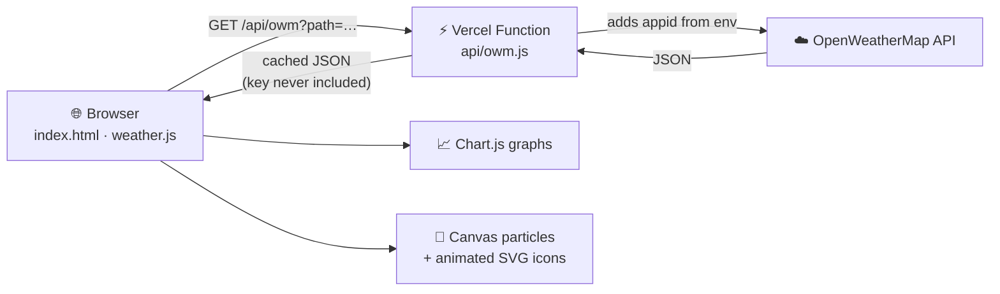

<div align="center">



<a href="https://git.io/typing-svg">
  
</a>

<br/>


**[🌐 Live Demo](https://live-weather-app-gamma-inky.vercel.app/)** &nbsp;•&nbsp; **[✨ Features](#-features)** &nbsp;•&nbsp; **[🚀 Quick Start](#-quick-start)** &nbsp;•&nbsp; **[🔐 Security](#-security-model)** &nbsp;•&nbsp; **[🗂 Structure](#-project-structure)**

</div>


## 📖 Overview

**Live Weather** is a fast, mobile-first weather dashboard written in **vanilla HTML, CSS and JavaScript**, with no framework and no build step.

The whole screen follows the sky outside. The background, accent colour, particle effects and the animated weather illustration all change with the current condition and with day or night in the _searched city_.

Behind the interface, a tiny serverless proxy keeps the OpenWeather API key on the server, so it can never be read from the browser.

```text
Browser  ──►  /api/owm  (Vercel function, holds the secret)  ──►  OpenWeatherMap
```

---

## ✨ Features

### 🎨 Look and feel

|                               |                                                                                                                                                               |
| ----------------------------- | ------------------------------------------------------------------------------------------------------------------------------------------------------------- |
| ☀️ **Animated SVG icons**     | Custom icons, no system emoji: rotating sun rays, twinkling moon and stars, drifting clouds, falling rain and snow, flashing lightning, sliding mist and wind |
| 🌈 **Living sky**             | Smooth cross-fade between 10 sky themes: clear, clouds and rain (day and night), plus thunder, snow and mist                                                  |
| 🎯 **Adaptive accent colour** | Buttons, active tab, progress rings and the "Now" card follow the current sky                                                                                 |
| ❄️ **Canvas particles**       | Wind-slanted rain, snow, stars, drifting clouds, fog and lightning bolts                                                                                      |
| 🪟 **Glass UI**               | Dark glass panels tuned for readable text on every sky, count-up temperature and skeleton loading                                                             |
| ♿ **Accessible motion**      | Honours `prefers-reduced-motion`                                                                                                                              |

### 📊 Data

- 🌡️ Current temperature, feels-like, dew point, humidity, pressure trend, visibility and cloud cover
- 💨 Wind speed, gusts and a live direction arrow
- 🌅 Sun arc with sunrise, sunset and daylight length, all in the **searched city's local time**, plus a live city clock
- ⏱️ Hourly strip for the next 36 hours and a 5-day forecast with temperature range bars
- 🫁 Air Quality Index with a pollutant breakdown: PM2.5, PM10, O₃, NO₂, SO₂ and CO
- 💡 Smart tips for umbrella, heat, cold, wind, low visibility and air quality

### 📈 Seven interactive graphs (Chart.js)

| Tab                | What it shows              |
| ------------------ | -------------------------- |
| 🌡️ **Temperature** | Temperature and feels-like |
| 🌧️ **Rain**        | Rain chance and volume     |
| 🌬️ **Wind**        | Wind speed and gusts       |
| 💧 **Humidity**    | Humidity and cloud cover   |
| 🧭 **Pressure**    | Pressure trend             |
| 📅 **Daily range** | Daily low and high         |
| 🏭 **Air quality** | AQI forecast with PM2.5    |

### 🧰 Utilities

- 🔎 City suggestions while typing, keyboard friendly, and exact-place picking when names repeat
- 📍 "My location" button, recent searches, and the last city restored on launch
- 🔄 **°C / °F** toggle that also switches km/h ↔ mph and km ↔ mi, remembered between visits
- ⏰ Auto refresh every 10 minutes with an "Updated x min ago" label
- 🧯 Clear messages for city not found, missing key, rejected key, rate limit, offline and missing API route
- 📱 Installable PWA: **Add to Home Screen** works on Android and iOS
- ⌨️ Press <kbd>/</kbd> on a keyboard to jump to the search box

---

## 🏗 Architecture



---

## 🚀 Quick Start

### Prerequisites

- A free [OpenWeather API key](https://openweathermap.org/api). New keys can take up to 2 hours to activate.
- [Node.js](https://nodejs.org/) and the [Vercel CLI](https://vercel.com/docs/cli) for local development

### Run locally

```bash
# 1. Clone the repository
git clone https://github.com/duttaanubhab777-code/Live-Weather-App.git
cd Live-Weather-App

# 2. Add your key (this file is git-ignored)
cp .env.example .env.local
#    then edit .env.local → OPENWEATHER_API_KEY=your_key

# 3. Start the dev server
npm i -g vercel
vercel dev          # → http://localhost:3000
```

> [!NOTE]
> Opening `index.html` directly, or serving it with a plain static server, will not work. The `/api/owm` route only exists on Vercel or under `vercel dev`. The app tells you this on screen instead of failing silently.

### Deploy on Vercel

1. Push the project to GitHub and **import** it in [Vercel](https://vercel.com/new). Framework preset: **Other**, with no build command.
2. Open **Settings → Environment Variables** and add:

    | Name                  | Value                |
    | --------------------- | -------------------- |
    | `OPENWEATHER_API_KEY` | your OpenWeather key |

    Tick **Production**, **Preview** and **Development**, then save.

3. **Redeploy** (Deployments → latest → ⋯ → Redeploy). Environment variables only apply to _new_ deployments.

> [!WARNING]
> Do **not** use prefixes such as `NEXT_PUBLIC_` or `VITE_`. Those variables are deliberately exposed to the browser.

---

## 🔐 Security Model

Browser code is public: anyone can open DevTools and copy a key stored there. Live Weather avoids this by routing every request through `api/owm.js`.

<details>
<summary><b>🛡 What the proxy enforces</b> (click to expand)</summary>

<br/>

| Protection                  | Behaviour                                                                                                           |
| --------------------------- | ------------------------------------------------------------------------------------------------------------------- |
| 🔑 **Server-side key**      | Reads `process.env.OPENWEATHER_API_KEY`; the key is never returned to the client                                    |
| 🚪 **Endpoint allow-list**  | Only `weather`, `forecast`, `air_pollution`, `air_pollution/forecast`, `geo/direct` and `geo/reverse` are forwarded |
| 🧹 **Parameter allow-list** | Only `q`, `lat`, `lon`, `limit`, `units` and `lang` pass through; any `appid` sent by a visitor is ignored          |
| ⏱ **Timeout**               | Upstream calls abort after 9 seconds                                                                                |
| 🚦 **Method guard**         | Only `GET` is accepted                                                                                              |
| 💾 **Edge caching**         | 5 to 30 minutes for weather data and 24 hours for geocoding, which protects your free quota                         |
| 🧱 **Security headers**     | `nosniff`, a strict referrer policy and a scoped permissions policy via `vercel.json`                               |

</details>

> [!IMPORTANT]
> If an older version of this project had the key written in `weather.js`, it remains in your Git history. Treat it as leaked: create a **new** key on OpenWeather, delete the old one, and use the new one only as the environment variable.

---

## 🗂 Project Structure

```text
Live-Weather-App/
├── index.html              # Markup
├── style.css               # Layout, glass panels, sky themes, icon animations
├── weather.js              # Data, UI sections, charts, search, particles
├── icons.js                # Animated SVG weather icons and UI icons
├── api/
│   └── owm.js              # Vercel serverless proxy (holds the key)
├── vercel.json             # Security headers and caching
├── manifest.webmanifest    # "Add to Home Screen" configuration
├── favicon.svg             # Vector favicon
├── icon-192.png            # PWA icon
├── icon-512.png            # PWA icon
├── apple-touch-icon.png    # iOS home-screen icon
├── .env.example            # Template for local development
├── .gitignore
└── package.json
```

---

## 🧪 Tech Stack

<div align="center">

| Layer          | Technology                                                                                     |
| -------------- | ---------------------------------------------------------------------------------------------- |
| **Frontend**   | HTML5, CSS3, vanilla JavaScript (ES6+)                                                         |
| **Graphs**     | [Chart.js 4.4](https://www.chartjs.org/)                                                       |
| **Effects**    | Canvas 2D particles, inline animated SVG                                                       |
| **Backend**    | Vercel Serverless Function (Node.js)                                                           |
| **Data**       | [OpenWeather](https://openweathermap.org/) Weather, Forecast, Air Pollution and Geocoding APIs |
| **Typography** | Bricolage Grotesque (Google Fonts)                                                             |

</div>

---

## 📝 Changelog

### v2.0.0

- 🔒 **Security:** the API key is no longer in the code; requests go through `/api/owm`
- 🐛 **Fixed:** an older, slower search could overwrite a newer one
- 🐛 **Fixed:** a failed first load left a blank screen; there is now an error card with a Retry button
- 🐛 **Fixed:** day/night detection now uses OpenWeather's own flag, which also works in polar regions
- 🐛 **Fixed:** the "Today" label in the 5-day list now compares real local dates
- 🐛 **Fixed:** switching graph tabs no longer resets the tab bar's scroll position
- 🐛 **Fixed:** particles no longer rebuild when a phone's address bar shows or hides
- 🐛 **Fixed:** improved contrast of white text on the bright clear-day sky
- 🐛 **Fixed:** location errors (blocked, timeout) now explain what to do
- ✨ **New:** custom SVG icons, sky-linked accent colour, sun arc, progress rings, custom search suggestions, offline handling and a PWA manifest

---

## 🙏 Acknowledgements

- Weather data by [OpenWeather](https://openweathermap.org/)
- Charts by [Chart.js](https://www.chartjs.org/)
- Hosting by [Vercel](https://vercel.com/)

---

<div align="center">

### Made with ☁️ and ☀️ by **Anubhab Dutta**

[](https://github.com/duttaanubhab777-code)

⭐ **If you like this project, please give it a star!** ⭐


</div>
